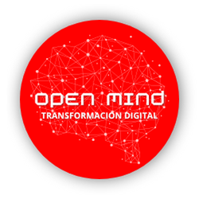

# OpenMind

**Transformación Digital**

Infraestructura · Procesos de negocio · Desarrollo · Automatización

---

## 🧠 Quiénes somos

Somos una empresa argentina de tecnología dedicada a la transformación digital de pymes en todo el país. Acompañamos a cada organización de punta a punta: desde la infraestructura que sostiene su operación hasta los procesos de negocio, las aplicaciones y las herramientas que usa su equipo todos los días.

Trabajamos con objetivos concretos y resultados medibles, sin conceptos abstractos ni promesas vacías, con la agilidad de un equipo chico y la experiencia de haber llevado adelante proyectos en grandes organizaciones.

## 🎯 Misión

Ayudar a las pymes a crecer a través de la tecnología, con soluciones **concretas, medibles y a su medida** que ordenen su infraestructura, optimicen sus procesos y liberen a su equipo de las tareas repetitivas.

## 🔭 Visión

Ser el **socio tecnológico de referencia** para las pymes argentinas, acercándoles las mismas herramientas y buenas prácticas que usan las grandes empresas, a un costo y en tiempos accesibles.

## 🤝 Valores

| | |
|---|---|
| 📊 **Resultados medibles** | 🧩 **Soluciones a medida** |
| 🤝 **Cercanía y acompañamiento** | 🔍 **Transparencia** |
| 🚀 **Mejora continua** | |

## 🛠️ Qué hacemos

| | |
|---|---|
| 🧭 **Diagnóstico y consultoría** | Relevamos procesos, tecnología y objetivos, detectamos cuellos de botella y entregamos una hoja de ruta priorizada. |
| 🖥️ **Infraestructura y arquitectura** | Servidores propios y en la nube (AWS, GCP), bases de datos, redes, seguridad y acceso remoto seguro, pensados para escalar. |
| 🔄 **Procesos de negocio y automatización** | Optimizamos circuitos de trabajo y eliminamos tareas manuales con RPA, integraciones y bots de atención (incluido WhatsApp). |
| 💻 **Desarrollo de aplicaciones** | Aplicaciones web y móviles a medida, APIs e integraciones entre sistemas, con código limpio y foco en el usuario. |
| 🎫 **Mesa de ayuda e ITSM** | Implementación y personalización de **GLPI**: tickets, SLA, reportes e inventario de activos. |
| 🌐 **Presencia web** | Sitios institucionales y comercio electrónico. |
| 🎓 **Capacitación y soporte** | Formación de equipos, documentación y acompañamiento continuo después de cada implementación. |

## 🗺️ Cómo trabajamos

1. **Diagnóstico** — Entendemos tus procesos, tu tecnología y tus objetivos.
2. **Diseño** — Definimos la solución, la arquitectura, los plazos y las métricas de éxito.
3. **Implementación por etapas** — Entregamos en fases para validar el avance en cada paso.
4. **Capacitación y adopción** — Formamos a tu equipo y documentamos todo.
5. **Mejora continua** — Medimos indicadores y optimizamos después de la puesta en marcha.

## 📍 Contacto

- 🌐 Sitio web: [openmind.com.ar](https://www.openmind.com.ar/)
- ✉️ Email: [info@openmind.com.ar](mailto:info@openmind.com.ar)
- 💼 LinkedIn: [OpenMind](https://www.linkedin.com/company/openmindti)
- 🇦🇷 Atención en todo el país

---

## 💻 Sobre esta organización

Este espacio de GitHub reúne las herramientas y desarrollos de OpenMind. Los repositorios de uso interno y de clientes son privados.

© OpenMind · Transformación Digital

